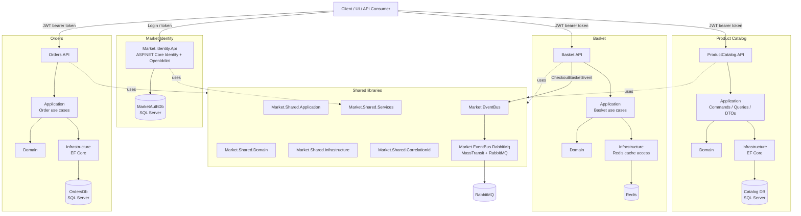
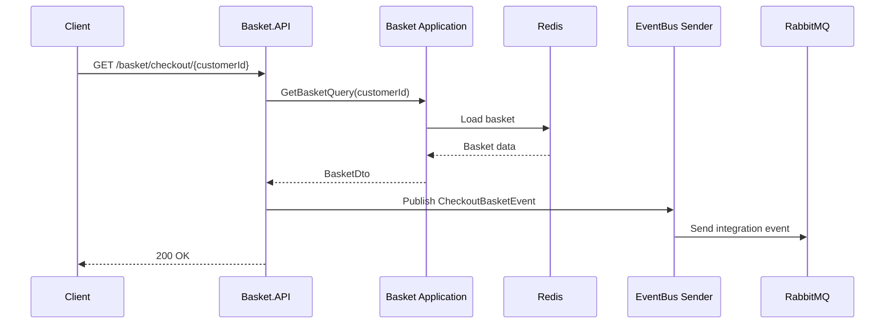

# Market

Market is a modular e-commerce sample platform built with ASP.NET Core and .NET 8. The repository is organized around separate business capabilities: product catalog, basket, orders, identity, and shared cross-cutting libraries.

The project demonstrates a service-oriented architecture with Clean Architecture-style layering, API versioning, OpenAPI/Swagger documentation, JWT-based authentication, Entity Framework Core persistence, Redis-backed basket storage, and RabbitMQ/MassTransit-based integration events.

## Repository description

> Modular .NET 8 e-commerce platform with Product Catalog, Basket, Orders, and Identity services. Uses ASP.NET Core, EF Core, Redis, RabbitMQ/MassTransit, OpenIddict, Swagger/NSwag, and Clean Architecture-style project separation.

## Main capabilities

- Product catalog management: products, catalogs, and measurement units.
- Basket management: get, update, delete, and checkout customer baskets.
- Order service foundation: separate Orders bounded context with its own API, application, domain, infrastructure, and tests.
- Identity service: users, roles, ASP.NET Core Identity, OpenIddict authentication flows, and external provider placeholders.
- Integration events: basket checkout publishes an event through a shared event bus abstraction backed by RabbitMQ/MassTransit.
- API documentation: Swagger/NSwag support for API exploration and client generation.
- Testing structure: unit and integration test projects per bounded context.
- CI/CD foundation: Azure Pipelines configuration for restore, build, test, publish, and artifact creation.

## Technology stack

| Area | Technology |
|---|---|
| Runtime | .NET 8 / ASP.NET Core |
| Architecture | Modular monolith / service-oriented bounded contexts, Clean Architecture-style layering |
| API style | REST APIs, API versioning |
| Application layer | CQRS-style commands/queries with MediatR-style request handling |
| Validation/mapping | FluentValidation, AutoMapper |
| Persistence | Entity Framework Core, SQL Server, optional PostgreSQL package in Product Catalog infrastructure |
| Basket storage | Redis via `Microsoft.Extensions.Caching.StackExchangeRedis` |
| Messaging | MassTransit + RabbitMQ |
| Identity/Auth | ASP.NET Core Identity, OpenIddict, JWT bearer authentication |
| API docs | Swagger, NSwag |
| DevOps | Azure Pipelines, Bicep infrastructure files |

## Solution structure

```text
src/
├── Market.sln
├── ProductCatalog/
│   ├── API/
│   ├── Application/
│   ├── Domain/
│   ├── Infrastructure/
│   └── tests/
├── Basket/
│   ├── src/
│   │   ├── API/
│   │   ├── Application/
│   │   ├── Domain/
│   │   └── Infrastructure/
│   └── tests/
├── Orders/
│   ├── src/
│   │   ├── API/
│   │   ├── Application/
│   │   ├── Domain/
│   │   └── Infrastructure/
│   └── tests/
├── MarketIdentity/
│   ├── Market.Identity.Api/
│   └── Tests/
└── Shared/
    ├── Market.Shared.Application/
    ├── Market.Shared.Domain/
    ├── Market.Shared.Infrastructure/
    ├── Market.Shared.Services/
    ├── Market.Shared.CorrelationId/
    ├── Market.EventBus/
    └── Market.EventBus.RabbitMq/
```

## Architecture overview

The repository follows a bounded-context structure. Each main business area owns its API, application logic, domain model, infrastructure, and tests. Shared packages contain cross-cutting abstractions and implementation helpers used by several services.

### Layer responsibilities

| Layer | Responsibility |
|---|---|
| API | HTTP endpoints, API versioning, Swagger/NSwag setup, authentication/authorization policies, request routing |
| Application | Use cases, commands, queries, DTOs, validation, mapping, orchestration |
| Domain | Core business entities, domain rules, value objects, domain abstractions |
| Infrastructure | Database access, EF Core configuration, migrations, external services, Redis integration |
| Shared | Common abstractions for application, domain, infrastructure, event bus, correlation ID, and shared services |

## Architecture diagram



## Checkout flow



## Services

### Product Catalog API

Responsible for product catalog data. It exposes versioned REST endpoints for:

- Products: get, add, update, delete.
- Catalogs: get, add, update, delete.
- Units: get, add, update, delete.

The API configures Swagger, API versioning, JWT bearer authentication, authorization policy for `product-catalog-api`, health checks, and EF Core migration/seed initialization in development.

### Basket API

Responsible for customer basket operations:

- Get basket by customer ID.
- Update basket.
- Delete basket.
- Checkout basket.

The checkout endpoint loads the basket and publishes `CheckoutBasketEvent` through the shared event bus abstraction. Basket infrastructure uses Redis configuration for basket storage.

### Orders API

Responsible for the order bounded context. The service follows the same layered structure as the other contexts: API, Application, Domain, Infrastructure, and tests. The current structure provides the foundation for order use cases and persistence.

### Market Identity API

Responsible for authentication and identity management. It uses:

- ASP.NET Core Identity for users and roles.
- OpenIddict for OAuth2/OpenID Connect flows.
- Quartz integration for OpenIddict background cleanup tasks.
- EF Core SQL Server persistence.
- Email configuration placeholders.
- Google provider configuration placeholders.

The API exposes user and role management endpoints.

## Shared libraries

| Project | Purpose |
|---|---|
| `Market.Shared.Application` | Shared application abstractions and packages such as MediatR, AutoMapper, FluentValidation, and EF Core dependencies |
| `Market.Shared.Domain` | Shared domain abstractions |
| `Market.Shared.Infrastructure` | Shared infrastructure utilities |
| `Market.Shared.Services` | Common service helpers |
| `Market.Shared.CorrelationId` | Correlation ID support for request/event tracing |
| `Market.EventBus` | Event bus abstractions and base integration event contracts |
| `Market.EventBus.RabbitMq` | RabbitMQ/MassTransit implementation of the event bus sender |

## Build

From the repository root:

```bash
dotnet restore src/Market.sln
dotnet build src/Market.sln
```

The repository pins the .NET SDK using `global.json`.

## Run services locally

Run each API from its project folder:

```bash
# Identity
cd src/MarketIdentity/Market.Identity.Api
dotnet run

# Product Catalog
cd src/ProductCatalog/API
dotnet run

# Basket
cd src/Basket/src/API
dotnet run

# Orders
cd src/Orders/src/API
dotnet run
```

Depending on the service, local infrastructure may be required:

- SQL Server for Identity, Product Catalog, and Orders persistence.
- Redis for Basket storage.
- RabbitMQ for integration events.

## Test

Run all tests from the root solution:

```bash
dotnet test src/Market.sln
```

Or run tests for a bounded context:

```bash
dotnet test src/ProductCatalog/ProductCatalog.sln
dotnet test src/Basket/Basket.sln
dotnet test src/Orders/Orders.sln
```

## CI/CD

The root `azure-pipelines.yml` contains a pipeline for Product Catalog that restores packages, builds the API, runs test projects, publishes the API, and uploads a pipeline artifact.

## Configuration notes

Before production usage, review and harden configuration:

- Move database credentials and other secrets out of `appsettings.json` into user secrets, environment variables, Azure Key Vault, or another secret store.
- Replace development signing/encryption certificates with production certificates for OpenIddict.
- Review CORS policies and avoid broad `AllowAnyOrigin` policies in production.
- Enable and enforce authorization attributes where currently commented out.
- Align CI SDK versions with the `global.json` SDK version.
- Add Docker Compose or local infrastructure scripts if you want one-command startup for SQL Server, Redis, RabbitMQ, and APIs.

## Suggested GitHub topics

```text
dotnet aspnetcore ecommerce clean-architecture microservices cqrs mediatr ef-core redis rabbitmq masstransit openiddict swagger azure-pipelines
```
